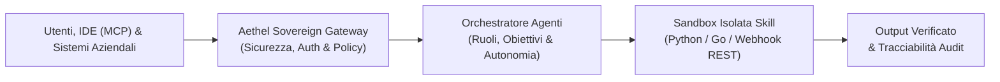

<div align="center">

# AETHEL
### Intelligenza Artificiale Sovrana sviluppata da TerminusCode

**Piattaforma Enterprise Autonoma per Agenti Intelligenti, Skill Verificate e Governance Operativa.**

[](https://aethel.terminuscode.com)
[](https://aethel.terminuscode.com)
[](docs/CTO_EXECUTIVE_BRIEF.md)
[](#integrazione-enterprise-rest-api--mcp)
[](SECURITY.md)

<p align="center">
  <a href="#cosè-aethel">Panoramica</a> •
  <a href="#perché-i-cto-scelgono-aethel">Perché Aethel (CTO)</a> •
  <a href="#catalogo-agenti-sovrani--skill">Agenti & Skill</a> •
  <a href="#creazione-skill-e-agenti-personalizzati">Crea Skill & Agenti</a> •
  <a href="#integrazione-enterprise-rest-api--mcp">API & MCP</a> •
  <a href="#sicurezza-privacy--governance">Sicurezza & Governance</a>
</p>

</div>

---

## Cos'è Aethel

**Aethel** è la piattaforma di **intelligenza artificiale sovrana** progettata e sviluppata da **TerminusCode** per aziende, team di ingegneria, professionisti e istituzioni che richiedono capacità cognitive di nuova generazione **senza cedere il controllo sui propri dati, sui processi critici o sulla propria infrastruttura**.

A differenza dei modelli cloud generici vincolati a ecosistemi terzi, Aethel offre un ambiente unificato in cui i team possono:
* **Attivare Agenti Specializzati pronti alla produzione** su domini ad alta criticità (ingegneria, finanza, sanità, compliance, software, cybersecurity).
* **Costruire ed eseguire Skill personalizzate** in ambienti isolati e verificati, collegandole direttamente ai sistemi aziendali esistenti.
* **Governare autonomia, sicurezza e conformità** con controlli trasparenti, tracciabilità completa e piena aderenza ai requisiti europei (GDPR ed EU AI Act).

---

## Perché i CTO scelgono Aethel

| Dimensione Strategica | Piattaforme Cloud AI Tradizionali | **Aethel by TerminusCode** |
| :--- | :--- | :--- |
| **Sovranità dei Dati** | Dati instradati verso provider esterni con policy mutevoli | **Controllo integrale**, riservatezza nativa e nessun lock-in esterno |
| **Estensibilità Operativa** | Plugin rigidi e dipendenza da marketplace proprietari | **Creazione nativa di Skill (Python, Go, Webhook) e Agenti su misura** |
| **Sicurezza Esecutiva** | Esecuzione opaca lato provider | **Sandbox isolate** con limiti stretti di memoria, tempo e permessi |
| **Conformità Normativa** | Responsabilità scaricata sull'azienda cliente | **Privacy-by-Design**, supervisione umana configurabile (EU AI Act) |
| **Integrazione nei Flussi** | Connettori frammentati | **Studio Web, REST API standard e Model Context Protocol (MCP)** |

### Flusso Operativo ad Alto Livello



---

## Catalogo Agenti Sovrani & Skill

Aethel integra un parco operativo di **oltre 340 Skill native** e **Agenti Sovrani verticali** già pronti per l'adozione aziendale, personalizzabili o estendibili dal proprio team:

| Verticale Industriale | Agente Sovrano | Capacità Operative & Casi d'Uso Principali |
| :--- | :--- | :--- |
| **Automotive & Meccatronica** | **Aethel AutoTech** | Diagnostica telemetrica, analisi parametri centraline ECU e verifica mappe motore. |
| **Elettronica & Hardware EDA** | **Aethel CircuitLab** | Verifica regole di fabbricazione PCB (DRC), calcolo impedenze linee e signal integrity. |
| **Finanza & Risk Management** | **Aethel QuantRisk** | Analisi portafogli multi-asset, calcolo Value-at-Risk (VaR) e simulazioni di stress-test. |
| **Sanità & Supporto Clinico** | **Aethel MediGuard** | Triage informativo, controllo incrociato di interazioni farmacologiche e supporto documentale. |
| **Diritto & Compliance UE** | **Aethel LexCompliance** | Audit di aderenza GDPR ed EU AI Act, valutazione requisiti di supervisione umana. |
| **Software Engineering** | **Aethel DevMaster** | Architettura microservizi, refactoring, generazione test automatici e risoluzione difetti. |
| **Cybersecurity** | **Aethel CyberSentinel** | Analisi vulnerabilità su API e applicazioni, revisione permessi e postura Zero-Trust. |
| **Market & Data Intelligence** | **Aethel MarketPulse** | Raccolta dati strutturati da fonti aperte, analisi competitiva e sintesi strategica. |
| **Product Design & UI/UX** | **Aethel VisualStudio** | Progettazione interfacce responsive, design system moderni e verifica accessibilità. |

> 📄 Consulta le schede complete e i casi d'uso nel **[Catalogo Ufficiale Agenti & Skill](docs/CATALOGO_AGENTI_E_SKILL.md)**.

---

## Creazione Skill e Agenti Personalizzati

Ogni organizzazione può modellare le proprie competenze proprietarie in pochi minuti, sia tramite interfaccia visuale sia via codice/API.

### 1. Creare una Skill (Capacità Eseguibile)

Una **Skill** incapsula una regola di business, un calcolo ingegneristico o un'integrazione verso un sistema interno. La funzione di ingresso riceve i parametri strutturati in un dizionario `args` e restituisce un risultato JSON verificato.

```python
def run(args: dict) -> dict:
    '''
    Calcola un preventivo commerciale applicando sconti per volume e fascia cliente.
    '''
    importo_base = float(args.get("importo_base", 0.0))
    volume = int(args.get("volume_articoli", 1))
    cliente_premium = bool(args.get("cliente_premium", False))

    sconto = 15.0 if volume >= 100 else (10.0 if volume >= 50 else (5.0 if volume >= 20 else 0.0))
    if cliente_premium:
        sconto = min(sconto + 5.0, 25.0)

    risparmio = round((importo_base * sconto) / 100.0, 2)
    return {
        "status": "CALCOLO_COMPLETATO",
        "sconto_applicato_pct": sconto,
        "risparmio_euro": risparmio,
        "totale_finale_euro": round(importo_base - risparmio, 2)
    }
```

### 2. Creare un Agente Autonomo

Un **Agente Sovrano** combina identità, linee guida operative, un perimetro esplicito di Skill autorizzate e un livello di autonomia governabile (*supervisionato* o *autonomo*).

```json
{
  "name": "Aethel Commercial Specialist",
  "role": "Consulente commerciale B2B per preventivazione e condizioni di fornitura",
  "system_prompt": "Assisti il cliente con chiarezza e rigore. Usa sempre la skill collegata per ogni calcolo economico e riepiloga tutte le condizioni prima della conferma.",
  "tools": ["calcola_preventivo", "verifica_disponibilita_prodotto"],
  "autonomy_level": "supervised"
}
```

> 📘 Per il walkthrough completo (Studio Visuale, Python, Go, Webhook REST e Community): **[Guida Creazione Skill e Agenti](docs/GUIDA_CREAZIONE_SKILL_E_AGENTI.md)**.

---

## Integrazione Enterprise (REST API & MCP)

### Quickstart REST API (cURL)

```bash
# 1. Registra una nuova Skill eseguibile a caldo
curl -X POST "https://aethel.terminuscode.com/api/v1/forge/skills"   -H "Content-Type: application/json"   -d '{
    "name": "calcolo_fiscale_fattura",
    "description": "Calcola imponibile, IVA e totale documento",
    "runtime": "python_jit",
    "execution_code": "def run(args):
    imp = float(args.get("importo_netto", 0))
    iva = round(imp * 0.22, 2)
    return {"imponibile": imp, "iva": iva, "totale": round(imp + iva, 2)}",
    "timeout_ms": 2000,
    "max_memory_mb": 128
  }'

# 2. Esegui la Skill in sandbox isolata
curl -X POST "https://aethel.terminuscode.com/api/v1/forge/skills/run"   -H "Content-Type: application/json"   -d '{
    "skill_id": "calcolo_fiscale_fattura",
    "parameters": { "importo_netto": 3500.0 }
  }'
```

### Integrazione IDE & Client Agentici via MCP (Model Context Protocol)

Collega Aethel direttamente a Cursor, VS Code, JetBrains o client conformi a MCP usando [`examples/mcp_config.json`](examples/mcp_config.json):

```json
{
  "mcpServers": {
    "aethel-sovereign": {
      "url": "https://aethel.terminuscode.com/mcp/sse",
      "transport": "sse"
    }
  }
}
```

---

## Sicurezza, Privacy & Governance

Aethel è concepita per soddisfare i requisiti di **CTO, CISO e DPO** in contesti regolamentati:

* **Isolamento Workspace Private-by-Default:** Ogni Agente e Skill creati restano privati nell'ambiente del team; la pubblicazione nella Community è sempre una scelta esplicita.
* **Esecuzione Controllata delle Skill:** Ogni esecuzione applica quote rigorose di memoria e timeout, impedendo blocchi di sistema o operazioni non autorizzate.
* **Human-in-the-Loop (EU AI Act Ready):** Supporto nativo per modalità assistita con approvazione umana esplicita prima di azioni critiche o comunicazioni esterne.
* **Trasparenza e Auditability:** Tracciamento strutturato delle invocazioni, degli input/output e delle versioni degli strumenti eseguiti.

Approfondisci nell'**[Executive Brief per CTO & CISO](docs/CTO_EXECUTIVE_BRIEF.md)** e nella nostra **[Security Policy](SECURITY.md)**.

---

## Risorse Ufficiali & Struttura del Repository

| Risorsa | Descrizione | Link |
| :--- | :--- | :--- |
| **Portale Web Ufficiale** | Accesso alla piattaforma Aethel | [aethel.terminuscode.com](https://aethel.terminuscode.com) |
| **Aethel Studio Forge** | Ambiente visuale per creare, testare e gestire Agenti e Skill | [aethel.terminuscode.com/forge](https://aethel.terminuscode.com/forge) |
| **Community Hub** | Forum condiviso, showcase e clonazione 1-click di Agenti & Skill | [aethel.terminuscode.com/it/community](https://aethel.terminuscode.com/it/community) |
| **CTO Executive Brief** | Architettura decisionale, governance, SLA e adozione enterprise | [docs/CTO_EXECUTIVE_BRIEF.md](docs/CTO_EXECUTIVE_BRIEF.md) |
| **Guida Sviluppatori** | Tutorial completo su Skill Python/Go/Webhook e Agenti | [docs/GUIDA_CREAZIONE_SKILL_E_AGENTI.md](docs/GUIDA_CREAZIONE_SKILL_E_AGENTI.md) |
| **Catalogo Agenti** | Panoramica completa dei 9 verticali operativi | [docs/CATALOGO_AGENTI_E_SKILL.md](docs/CATALOGO_AGENTI_E_SKILL.md) |
| **Esempi Pronti** | Template Python, JSON, cURL e configurazione MCP | [`examples/`](examples/) |

---

<div align="center">

**Aethel** — Intelligenza Artificiale Sovrana sviluppata da **TerminusCode**.  
© TerminusCode. Tutti i diritti riservati.

</div>

---

## Ecosistema Developer v5.0 — SDK, OpenAPI 3.1, Estensione Browser & Suite Enterprise

* **Specifica OpenAPI 3.1 Live**: `https://aethel.terminuscode.com/openapi.json`
* **Status & SLA Live**: `https://aethel.terminuscode.com/api/v1/status/sla` (**42 settori** · **52+ lingue**)
* **SDK Ufficiali**: [`sdk/python/aethel_sdk.py`](sdk/python/aethel_sdk.py) · [`sdk/typescript/aethel_sdk.ts`](sdk/typescript/aethel_sdk.ts)
* **Estensione Browser Chrome/Edge (MV3)**: [`integrations/browser-extension/`](integrations/browser-extension/)
* **Installer MCP 1-Click (VS Code / Cursor / Claude Desktop)**: [`integrations/ide-mcp/install_aethel_mcp.py`](integrations/ide-mcp/install_aethel_mcp.py)
* **Capabilities Enterprise v5.0**: Export binari nativi (`.xlsx` ISO OpenXML con formule, `.docx`, Report PDF A4, Slide Deck 16:9), Data Analyst deterministico CSV/JSON, Sandbox codice isolata, Redline Diff contrattuale, Knowledge Base Privata (PDF/DOCX + RBAC), Deep Research citato, Agenti Schedulati, SSO (`SAML 2.0 / OIDC`), Zero-Data-Retention/BYOK e Audit Log esportabile SIEM/EU AI Act con sigillo SHA-256.
